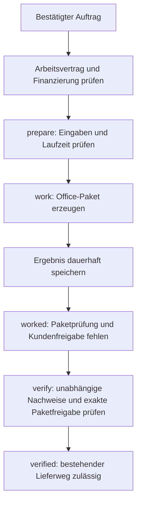

# Zweistufiger uGig-Auftragsablauf für DOCX und XLSX

Datum: 20. Oktober 2026. Status: schriftlicher Entwurf von Patrice bestätigt; konkreter Implementierungsplan angefordert. Ausführung des Plans noch nicht begonnen.

## 1. Ziel und verbindliche Grenzen

Die vorhandenen Office-Erzeuger werden an den Auftragsablauf angeschlossen. Ein nachweislich vergebener, finanzierter und zur Bearbeitung freigegebener Auftrag darf ein lokales Paket erzeugen. Ein erzeugtes Paket darf erst nach unabhängiger Fachprüfung und ausdrücklicher Kundenfreigabe des exakten öffentlichen Pakets den vorhandenen Lieferweg erreichen.

Patrice hat den zweistufigen Ablauf und die Erstellung dieses Dokuments bestätigt. Dieser Auftrag erlaubt weder Kundennachrichten noch Uploads, Zahlungen, Kontoeinrichtungen oder Eingriffe in eine laufende Sitzung. Entwicklung und Abnahme erfolgen ausschließlich mit temporären Stores, synthetischen Daten und simulierten Plattformen. Eine spätere Aktivierung ist ein eigener Wartungsauftrag; ON-Sitzungen dürfen dafür nicht unterbrochen werden.

Vertrauliche und unbekannt klassifizierte Eingaben bleiben gesperrt, auch in verschachtelten Referenzen. Die bestehende persönliche Einschaltkontrolle, Kostenbudgets, Vorleistungsgrenzen und Zahlungsnachweise bleiben unverändert.

## 2. Ausgangslage und technische Ursache

Vorhanden und isoliert getestet:

- `scripts/ugig_office.py`: DOCX-/XLSX-Erzeugung, Rücklesen, Referenzabgleich und technische Berichte.
- `scripts/founder-ugig-office.mjs`: expliziter Vorbereitungsadapter mit erneuter Arbeitsberechtigungsprüfung und Binärimport.
- `scripts/founder-order-execution.mjs`: persistente Übergänge `prepare`, `work`, `verify`, `submit`.
- `scripts/founder-ugig-order-pipeline.mjs`: Vertrags-, Finanzierungs-, Fachprüfungs- und Lieferanbindung.
- `scripts/founder-ugig-evidence.mjs`: lesender Zugriff auf geprüfte Vertragspakete; keine Freigabeerzeugung.
- `scripts/founder-ugig-binary-delivery.mjs`: exakte Paketfreigabe, Binärtransport und Wiederaufnahme unsicherer Lieferungen.

Der bisherige Binärvertrag verlangt fertige `binaryArtifacts`, geprüfte Herkunft und Zustimmung zu deren Hashwerten bereits beim Lesen des Arbeitsvertrags. Sein Scope-Digest enthält diese Felder. Außerdem verlangt der bisherige Evidence-Reader gemeinsam die Operationen `read`, `work`, `verify`, `submit`, `reconcile`. Diese Anforderungen dürfen nicht pauschal abgeschwächt werden, um die Erzeugung früher auszuführen.

Die Anbindung erhält deshalb einen ausdrücklich versionierten Office-Vertrag mit getrennter Arbeits- und Lieferberechtigung. Alte Verträge und ihr Scope-Digest bleiben unverändert.

## 3. Geltungsbereich

| Gig | Fachart | Umfang der vorhandenen Erzeugung |
|---|---|---|
| `1d754c51-8a44-4a56-b004-e874117f5c48` | `document-cleanup` | Unveränderte Quellblöcke nach vorgegebener Gliederung; DOCX, Markdown, Änderungsbericht |
| `4ed05909-cba1-48d0-903e-7b7b25b3ddfc` | `support-templates` | Vorlagen, Varianten, Platzhalter, Eskalation, Sprachleitfaden, Checkliste |
| `6ba3dca1-f288-4600-a97b-722bdee28871` | `research-report` | Bereitgestellte Recherchewerte, Quellen, Abrufdaten und Fazit als XLSX/CSV/Markdown |
| `2cc65a54-dd93-49b0-9297-dbd05457f5cc` | `xlsx-automation` | Bestehende begrenzte Excel-Regeln, XLSX/CSV und ausführbares Übergabepaket |

Die vier Zuordnungen dienen der ersten Integrationsabnahme. Sie sind keine Vergabe- oder Arbeitsfreigabe. Weitere Aufträge dürfen erst über dieselben geprüften Vertragsanforderungen aufgenommen werden. Numaron wird nicht generell auf diese vier Tätigkeiten beschränkt.

Keine zusätzlichen Office-Formate, Makros, freie Codeausführung oder Formelauswertung. Die vorhandenen Grenzen von 10 MiB je Binärdatei, 40 MiB Binärpaket und 96.000 Bytes Textdatei-JSON bleiben bestehen. Die 256.000-Byte-Grenze des allgemeinen Evidenzformats wird nicht erhöht, um eingebettete Excel-Dateien unterzubringen.

## 4. Entscheidung und Alternativen

Gewählt: expliziter Office-Arbeitsvertrag plus separat geprüfte Paketfreigabe, verbunden durch unveränderliche Auftrags- und Produktdigests.

Verworfen: Platzhalter-Hashwerte oder fingierte öffentliche Zustimmung vor der Erzeugung. Das würde einen nicht existierenden Liefergegenstand freigeben.

Verworfen: nachträgliches Überschreiben des finanzierten Scope-Digests mit dem Paketdigest. Das würde bestehende Zahlungs- und Arbeitsnachweise auf einen anderen Gegenstand umdeuten.

Verworfen: alleinige manuelle Voraberzeugung außerhalb des Auftragsablaufs. Das wäre weiterhin keine Verbindung mit `prepare`/`work` und würde Wiederaufnahme und Auftragszuordnung dem Bediener überlassen.

## 5. Datenmodell und Digest-Regeln

### Office-Arbeitsvertrag

Neues diskriminiertes Schema `numaron-ugig-office-work-v1`; Ausführungsprofil `office-generation`. Der Vertrag enthält:

- Vollständigen `orderKey` aus `sourceId`, `externalId`, `ownerId`, dazu `rootTaskId`, `sourceRevision`, Gig-, Bewerbungs-, Käufer- und Gesprächs-ID.
- Nachweise für bestätigte Vergabe, Preis, Gebühren, Empfänger, Zahlungsmodell, Frist, Abnahmebedingungen und AI-Verarbeitung.
- Kundenbelegte Erlaubnis zur lokalen Erstellung der vereinbarten öffentlichen Dateien; erlaubte Ausgabeformate und vollständige Dateiliste. Diese Erlaubnis ist noch keine Veröffentlichungserlaubnis.
- `workKind`, Referenzen auf die konkreten Eingaben und Sollwerte sowie deren Byte-/Inhaltsdigests, Erzeugungsregeln und technische Grenzen.
- `generatorVersion`: Digest des vertrauenswürdigen Erzeugers und festgelegte Laufzeit-/Paketversionen. Kein aus Kundentext geladener Programmcode.

`scopeDigest` bleibt für diese Version der Digest des gesamten unveränderlichen Arbeitsumfangs einschließlich Regeln, Eingaben, Referenzen, Formaten und wirtschaftlichen Bedingungen. Er enthält keine erst später entstehenden Produktbytes oder Paketfreigaben. Diese Definition gilt ausschließlich für das neue, strikt validierte Schema. Unbekannte Versionen werden abgewiesen; kein Rückfall auf einen schwächeren Validator.

Ein gesonderter `workGrant` bindet den Digest des Arbeitsvertrags und erlaubt ausschließlich `read`, `work`, `verify`, mit Herkunftsbeleg und Ablaufzeit. Er erteilt keine Rechte zum Senden oder zur Lieferwiederaufnahme. Er wird ausschließlich gelesen, niemals vom Generator erstellt.

### Eingaben und Referenzen

Größere Dateien liegen in einem begrenzten lokalen Eingabespeicher; im Vertrag stehen sichere Inhaltsreferenzen, Dateigröße, SHA-256 und öffentliche Klassifizierung. Absolute vom Kunden bestimmte Pfade, Pfadwechsel, Symlinks und Hardlinks werden abgewiesen. Auflösung nur unter dem konfigurierten Speicherursprung. Vor Erzeugung werden Größe, tatsächliche Bytes und Digest erneut geprüft.

Der Adapter baut daraus intern das heute unterstützte `spec`-/`reference`-Format. Eingabedateien werden weder in den Vertrag noch in allgemeine Logs kopiert. Auch die Referenz und das ausgegebene Automationsrezept unterliegen der Vertraulichkeitsprüfung. Änderungen erfordern eine neue geprüfte Arbeitsrevision.

### Erzeugungsdatensatz

Persistenter Datensatz, adressiert durch `digest({orderKey,sourceRevision,scopeDigest,inputDigest,referenceDigest,generatorVersion})`, im Office-Journal. Enthalten sind Status, Versuch-ID, Ergebnisreferenzen, `binaryArtifacts`, Textdateimanifest, technischer Bericht, `packageDigest`, `productDigest` und offene Abnahmen.

`packageDigest` verwendet unverändert `mixedPackageDigest` über Binärmanifest und Textdateien. `productDigest` ist der bestehende Digest über die vollständigen `binaryManifestFiles`. Binärbytes bleiben im vorhandenen unveränderlichen Artefaktspeicher. Der Generator meldet weiterhin `independentlyVerified: false`.

Keine Neuberechnung der Dateien, um einen bereits vorliegenden Digest zu reproduzieren: Office-ZIP-Metadaten können zwischen Erzeugungen variieren. Wiederaufnahme verwendet die gespeicherten und erneut geprüften tatsächlichen Bytes.

### Paketfreigabe

Neues Schema `numaron-ugig-office-release-v1`, separat vom Arbeitsvertrag. Pflichtfelder:

- Exakte Arbeitsvertragsidentität und -revision, `scopeDigest`, Digest des Arbeitsvertrags sowie Erzeugungsdatensatz-ID.
- `packageDigest`, `productDigest`, Binär- und Textmanifest sowie vollständige Dateiliste.
- Kundenbeleg zur öffentlichen Speicherung des exakten Pakets und zum nummerierten Texttransport: Käufer, Gespräch, Nachricht, Inhaltsdigest und geprüfte Bezugnahme auf dieses Paket.
- Unabhängige Herkunfts- und Fachprüfung mit Prüferidentität, Gültigkeit und allen erforderlichen Nachweisen.
- Separater befristeter `deliveryGrant` für `submit` und `reconcile`, gebunden an den gesamten geprüften Freigabedatensatz.

Der Agent schreibt weder diesen Freigabedatensatz noch positive unabhängige Prüfnachweise. Ein Änderungswunsch, Widerruf oder eine neue ungeprüfte Kundennachricht blockiert die nächste Aktion entsprechend dem bestehenden Vertragsleser.

## 6. Ablauf und Persistenz

Die globalen Auftragszustände werden nicht erweitert. Der Office-Datensatz führt intern `prepared`, `generating`, `generated`, `interrupted`, `rejected`. Fehlende Fach-/Kundenfreigabe ist ein sichtbarer Blocker bei einem `worked`-Auftrag, kein Anlass zu weiterer Erzeugung oder wiederholten Nachrichten.

`prepare` prüft tatsächliche Vergabe, Arbeitsgrant, wirtschaftliche Bedingungen, unterstützte Ausgabe und Eingaben. `work` prüft die aktuelle Arbeitsberechtigung und Finanzierung erneut, erzeugt lokal, prüft die Berechtigung nochmals und speichert das Paket. `verify` benötigt technische Integrität, unabhängige Fachprüfung und exakte Kundenfreigabe. `submit` und `reconcile-delivery` prüfen diese Nachweise nochmals unmittelbar am Übergang.

Vor Erzeugungsbeginn wird ein eindeutiger Versuch dauerhaft beansprucht. Parallele Aufrufe desselben Auftrags dürfen keinen zweiten Prozess starten. Ergebnisdaten und Abschlussmarker werden atomar veröffentlicht. Der Hauptprozess schreibt `worked` erst nach dauerhaftem Ergebnisnachweis. Absturz zwischen Ergebniscommit und Zustandswechsel: erneuter Aufruf liest dasselbe Ergebnis und stellt den Zustand wieder her.

Absturz ohne vollständigen Ergebniscommit: Status `interrupted`; keine automatische zweite Erzeugung und kein erratenes Ergebnis. Ein explizit freigegebener neuer Versuch erhält eine neue Versuch-ID, muss aktuelle Berechtigung/Budget erneut prüfen und darf keine alten Dateien überschreiben. Verwaiste, nicht zugeordnete Artefakte werden nicht als Paket anerkannt.

OFF, Abbruchsignal und Berechtigungswiderruf werden vor Prozessstart, nach Prozessende, vor Import und vor Zustandscommit geprüft. Ein Abbruch darf einen vollständigen technischen Kandidaten hinterlassen, aber keine neue Arbeits- oder Lieferfreigabe. Keine Befugnis, eine echte ON-Sitzung für Wartung zu stoppen.

## 7. Verbindung zu bestehenden Prüf- und Lieferkomponenten

Der Office-Evidence-Reader ist getrennt vom bisherigen `numaron-ugig-reviewed-v1`-Reader. Er stellt geprüfte Arbeitsansicht und geprüfte Lieferansicht bereit. Die Lieferansicht wird ausschließlich aus unverändertem Arbeitsvertrag, gespeichertem Ergebnis und passender Paketfreigabe zusammengesetzt.

Die Lieferansicht verwendet das bestehende `reviewed-binary`-Format für den Transport und dieselben Manifest-/Zustimmungsprüfungen. Ihre Office-Herkunft muss explizit erkennbar und validiert sein; sie darf nicht als alter v1-Vertrag durch den bisherigen Scope-Validator laufen. `scopeDigest` bleibt der geprüfte Office-Arbeitsumfang, `productDigest`/`packageDigest` binden das konkrete Ergebnis. Die Ansicht wird bei jeder Autoritätsprüfung neu gebildet und ihr vollständiger Digest auf Änderungen geprüft.

Finanzierung wird immer gegen den ursprünglichen Office-Arbeitsumfang verifiziert. Kein Kopieren eines `verified: true`-Flags auf einen neuen Scope. Eine spätere Änderung der wirtschaftlichen Bedingungen oder Eingaben invalidiert den Erzeugungsschlüssel und alle bisherigen Paketfreigaben.

Die bestehenden uGig-Identitäts-, Gesprächs-, Aktualitäts- und Nachrichtenprüfungen werden wiederverwendet. Ein Office-Arbeitsgrant darf in der Quellenregistrierung ausschließlich Arbeits-/Prüffähigkeit begründen. `submit` darf erst durch einen gültigen separaten Liefergrant erreichbar werden. Eine globale Quellenfähigkeit allein ersetzt nie die konkrete Auftragsprüfung.

Der bisherige feste Content-Pilot bleibt in seinem Router. Alte Text-/Binärverträge behalten ihre bisherigen Validierungen und Digests. Die Einführung der Office-Version ist ausdrücklich auswählbar, keine automatische Migration vorhandener Aufträge.

## 8. Komponenten und Schnittstellen

| Komponente | Änderung / Verantwortung |
|---|---|
| Neues `founder-ugig-office-contract.mjs` | Office-Arbeits- und Freigabeschema, Digest-Berechnung, strikte Versions- und Identitätsprüfung |
| Neues `founder-ugig-office-evidence.mjs` | Lesende Auflösung von Arbeitsgrant, Inputreferenzen und Paketfreigabe; begrenzte Datei- und Pfadprüfung |
| Neues `founder-ugig-office-journal.mjs` | Versuch beanspruchen, unveränderliches Ergebnis committen, konkurrierende Aufrufe und Wiederaufnahme |
| `founder-ugig-office.mjs` | Vorhandenen Erzeuger an geprüfte Auftragsberechtigung und Journal anschließen; kein Freigabeschreiben |
| `founder-order-execution.mjs` | `office-generation` in `prepare`/`work`/`verify` explizit routen; gespeichertes Paket wiederverwenden; kein allgemeiner Sandbox- oder Textgenerator-Fallback |
| `founder-work-profiles.mjs`, `founder-native-work.mjs` und Profilzulassungen | Office-Profil mit vollständiger Dateizulassung und öffentlicher Datenpflicht aufnehmen; Berechtigungen anderer Profile unverändert |
| `founder-ugig-order-pipeline.mjs` | Office-Arbeitsansicht für Arbeit, Office-Lieferansicht für Prüfung/Transport; aktuelle Finanzierung und unabhängige Reviews |
| `founder-production-order-bindings.mjs` und Marketplace-Bindung | Explizite Office-Routen, getrennte Fähigkeiten und versionierte Vertragsbindung; Pilotroute erhalten |
| Bestehender Binärlieferadapter | Weiterverwendung der Byte-, Paket-, Kunden- und Versandprüfungen; nur nötige explizite Office-Ansicht akzeptieren |

Neue Methoden werden als vertrauenswürdige Kompositionsfunktionen übergeben, nicht als ausführbare Namen oder URLs aus Vertragsdaten. Fehlende Python-Konfiguration wird als fehlende Arbeitsfähigkeit angezeigt. Keine automatische Installation, kein Runtime-Download und keine stille Nutzung eines anderen Interpreters.

Die aktuelle Budgetreservierung wird auch bei deterministischer lokaler Arbeit verlangt. Ein tatsächlicher Nullbetrag wird nur als lokaler Kostenbeleg mit zugehöriger Reservierungs-ID zurückgegeben. Keine Erhöhung oder Umgehung von Budgets durch die Office-Route.

## 9. Isolierte Abnahme

Alle Tests benutzen temporäre Datenbanken, synthetische Aufträge und explizite Fake-Adapter. Jeder externe Versand-/Uploadaufruf zählt als Testfehler. Selbst der positive Ablauf endet an einer simulierten Versandgrenze. Keine Produktionsschlüssel oder echten Finanzabfragen.

| Testgruppe | Verbindlicher Nachweis |
|---|---|
| Vier positive Kandidaten | Von bestätigter Fake-Vergabe über `prepare`/`work` zu echtem DOCX/XLSX und gespeichertem Mischpaket; nach Fake-Fach-/Kundenfreigabe `verified` |
| Getrennte Rechte | Arbeitsgrant ohne `submit` reicht zur Erzeugung, niemals zur Lieferung; nur vorhandene Paketfreigabe ohne Arbeitsvertrag reicht für nichts |
| Identität | Fremder Auftrag, Käufer, Besitzer, Gespräch oder Revision blockiert; auch bei identischen Eingaben |
| Finanzierung | Fehlende, veraltete, geänderte oder falsch zugeordnete Nachweise blockieren vor Arbeit und vor Lieferung; unterstützte Vorleistung nur unter vorhandener Policy |
| Kundenzustimmung | Allgemeine Erlaubnis, alter Paketdigest, andere Nachricht, neuer ungeprüfter Kundenwunsch und Widerruf blockieren |
| Datenschutz | Fehlende/unklare Klassifizierung, vertrauliche Eingabe oder Referenz, Pfadwechsel, Symlink und Hardlink blockieren |
| Fachprüfung | Technischer Bericht allein, fehlender Prüfer, abgelaufener Nachweis, falscher Produktdigest und unvollständige Fachchecks blockieren |
| Wiederaufnahme | Wiederholung benutzt dieselben Bytes ohne Prozessstart; parallele Aufrufe starten höchstens einmal; unterbrochener Versuch wird nicht automatisch wiederholt |
| Absturzgrenzen | Fehler vor/bei/nach Journalcommit und vor `worked` erzeugen keinen falschen Abschluss; gespeicherter Abschluss lässt sich sicher wiederaufnehmen |
| Änderungen | Eingabe-, Regel-, Referenz-, Generator- und Vertragsänderung erkennen; alte Freigaben nicht übernehmen |
| OFF/Abbruch | Keine Provider-, Prozess-, Import- oder Freigabeaktion bei OFF; Abbruch zwischen Grenzen verhindert den nächsten Schritt |
| Grenzen | Überschrittene Dateigrößen, unvollständige Pakete, CSV-/Textlimit und unsupported Excel-Regeln blockieren ohne Kürzung |
| Bestand | Bisherige Vertrags-, Content-Pilot-, Binär-, Mischliefer-, Finanzierungs- und Budgettests bleiben grün |

Die bestehende Suite mit 126 bestandenen Tests ist Ausgangsevidenz, kein Nachweis dieser noch nicht implementierten Anbindung. Neue Tests müssen zunächst die fehlende Verbindung beziehungsweise Sperre zeigen und nach der Implementierung bestehen.

## 10. Abschlusskriterien und Restabhängigkeiten

Die Offline-Anbindung ist abgeschlossen, wenn alle vier synthetischen Aufträge den vollständigen Arbeits-/Prüfablauf erreichen, alle negativen Grenzen blockieren, Wiederaufnahme ohne erneute Erzeugung funktioniert und kein externer Versand erfolgt. Nachweise enthalten Codeversionen, Testausgaben und die tatsächlich geprüften Grenzen.

Damit wird keine reale Bewerbung zum Auftrag: echte Kundenzusage, Vertrags-/Finanzierungsnachweise, freigegebene Eingaben, unabhängige Produktprüfung und konkrete öffentliche Paketfreigabe bleiben erforderlich. Visuelle DOCX-Abnahme und nicht unterstützte Excel-Transformationen bleiben gesonderte fachliche beziehungsweise technische Grenzen. Ein späterer Echtbetrieb benötigt außerdem eine geprüfte Laufzeitkonfiguration und einen gesonderten, OFF-gesicherten Wartungsauftrag zur Aktivierung.

## 11. Selbstprüfung des Entwurfs

- Arbeits- und Lieferberechtigung sind getrennt; keine selbst ausgestellte Kundenzustimmung.
- Der finanzierte Arbeitsumfang bleibt stabil, Produktbytes sind zusätzlich exakt gebunden.
- Alte Vertragsversionen und der feste Content-Pilot werden nicht abgeschwächt oder migriert.
- Große Eingaben umgehen keine allgemeine Evidenzgrenze; Referenzen sind begrenzt und integritätsgeprüft.
- Wiederaufnahme behauptet keine Byte-Deterministik von Office-ZIP-Dateien.
- Technische Tests werden nicht als unabhängige Fachabnahme ausgegeben.
- Keine unaufgelösten Platzhalter; keine Live-Aktivierung oder Nachrichten im Implementierungsumfang.

Fortschreibung: Patrice hat diesen schriftlichen Entwurf bestätigt. Der konkrete Plan mit Testreihenfolge liegt unter `docs/superpowers/plans/2026-10-20-ugig-office-order-flow.md` zur Prüfung und Wahl der Ausführungsmethode vor. Dieser Entwurf selbst verändert keine Produktfunktion.
